# RETROit

**Transforme qualquer foto ou vídeo em uma imagem de videogame antigo, fita VHS ou TV de tubo.**

> **De onde veio o projeto.** O RETROit nasceu de um desafio: IAs não são boas em determinismo na hora de aplicar efeitos em imagens. Peça o mesmo efeito duas vezes e o resultado muda, e é impossível reproduzir o mesmo quadro depois ou repetir o visual em vídeo. A resposta foi tirar a decisão da IA e calcular cada efeito com uma conta fixa, em um shader: a mesma imagem com o mesmo preset dá **sempre o mesmo resultado**, até no ruído, que vem de um hash e não de sorteio.

O RETROit é um app de uma página só, sem instalação e sem dependências, que aplica uma cadeia de efeitos retrô e permite animá-los no tempo. Todos os efeitos rodam em **um único shader**, o mesmo no navegador e na placa de vídeo, o que também o torna fácil de levar para outros dispositivos e engines.

<p align="center">
  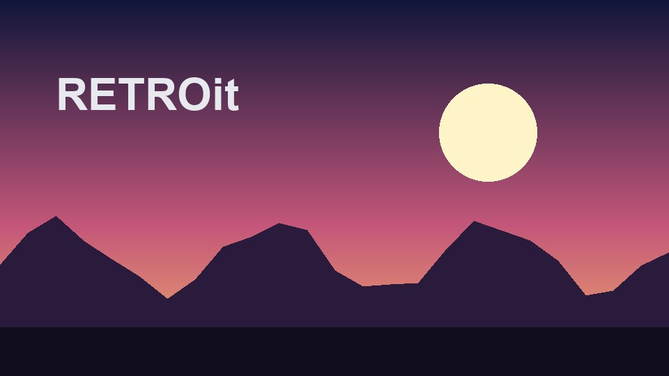
  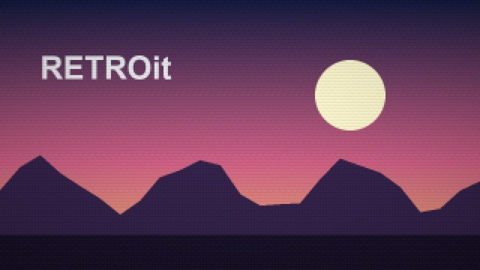
  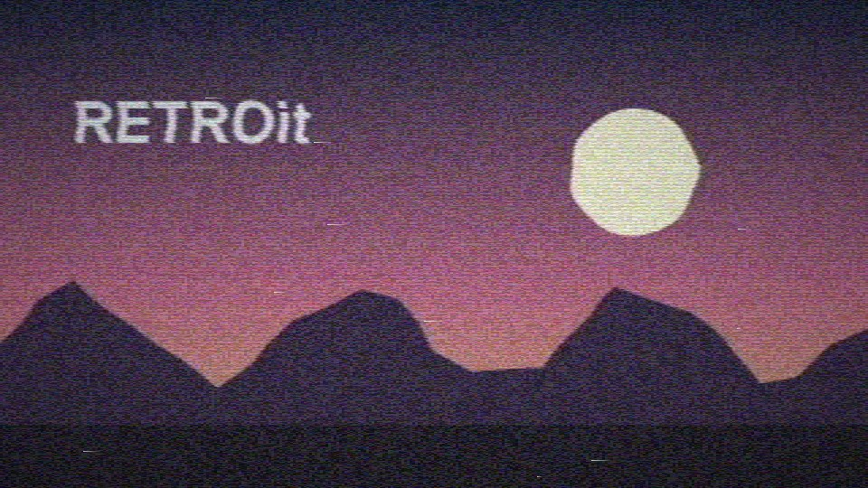
</p>
<p align="center">
  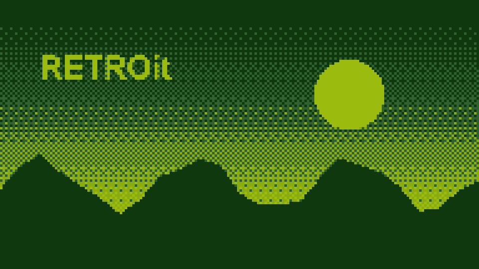
  
  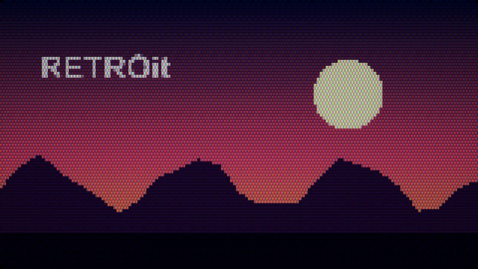
</p>
<p align="center"><sub>Mesma imagem, seis predefinições: original, PS1 clássico, VHS locadora, Game Boy, Analog horror e CRT células.</sub></p>

---

## Como usar

**No navegador.** Abra `retroit.html` em um navegador moderno (precisa de WebGL2; testado no Chrome e no Edge). Arraste uma foto, escolha uma predefinição e mexa nos controles. O resultado aparece na hora.

**Em vídeo ou em lote.** O script `shader/retroit-video.py` aplica o mesmo efeito, pela placa de vídeo, em imagens e vídeos:

```bash
pip install numpy pillow moderngl av

# imagem
python shader/retroit-video.py foto.png saida.png --preset preset.json --name "VHS locadora"

# vídeo (o áudio é preservado)
python shader/retroit-video.py video.mp4 saida.mp4 --preset preset.json
```

O `preset.json` é o arquivo que o botão **Exportar JSON** do app grava, inclusive o das animações. Precisa de uma placa de vídeo com OpenGL 3.3. O vídeo é codificado por NVENC quando a placa tem, ou por x264 caso contrário.

---

## Exemplo real: pós-processar um vídeo de verdade

O RETROit foi usado para dar o visual de fita ao Reel 9:16 do jogo *Mansão 468* (1080×1920, 30 fps). À esquerda o quadro original, à direita o resultado, no meio de uma varredura de linhas repetidas:

<p align="center">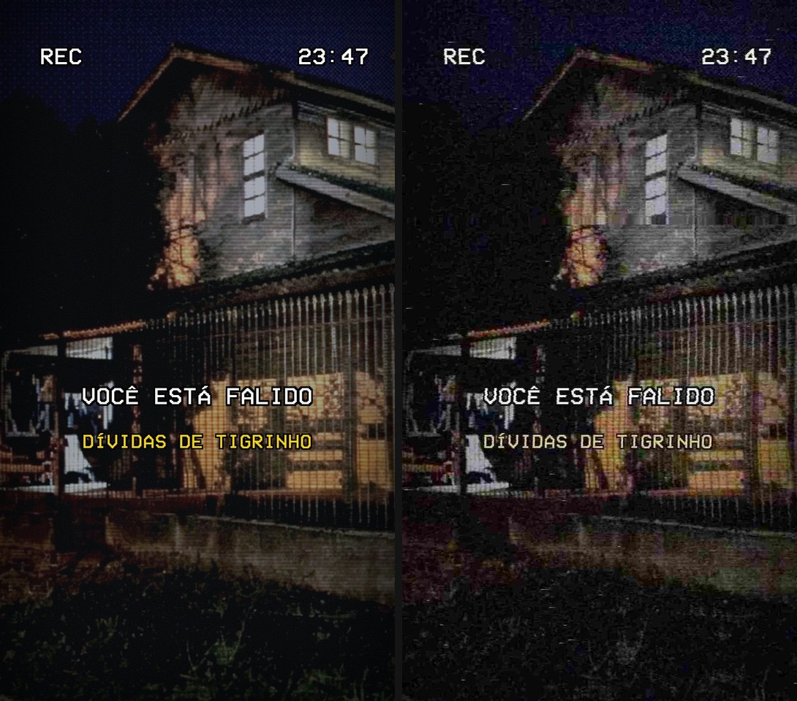</p>

**A cadeia** (na ordem real das etapas): NTSC do jogo, distorção (jitter por linha, onda horizontal lenta e linhas repetidas em varredura), fita magnética e recompressão JPEG. Tudo renova a 15 fps. Os valores estão em `shader/exemplos/reel-mansao-definitivo.json`.

**Como renderizar um vídeo como esse**

```bash
pip install numpy pillow moderngl av

# o vídeo todo (sai sem áudio; junte o áudio depois com o ffmpeg)
python shader/exemplos/analog-horror-video.py entrada.mp4 saida.mp4

# só os 8 primeiros segundos, com a varredura levando 8 s para descer
python shader/exemplos/analog-horror-video.py entrada.mp4 saida.mp4 --segundos 8 --varredura 8
```

O script `analog-horror-video.py` lê o preset estático e acrescenta o que muda no tempo, que o JSON de um quadro só não guarda: a fase do jitter, a fase da onda (4× mais lenta que o jitter) e a posição da varredura. Precisa de uma placa de vídeo com OpenGL 3.3.

**Dicas que custaram caro**
- **Grão:** o preset do NTSC do jogo já escala o grão pela altura (`uRatio`). Somar um `ntGrain` alto em cima dobra a escala e vira quadriculado. Para um vídeo de 1080 px, use `ntGrain` 3 a 6 com `uRatio` 1.
- **Cor da fita:** `tpShift` (deslocamento do croma) alto separa a cor da forma, e o shader arredonda para pixel inteiro. Os demais controles da fita (borrão, eco, halo, riscos) podem ir ao limite sem afastar a cor.
- **Ordem:** a varredura (distorção) vem antes da fita e do JPEG, então a compressão processa as linhas repetidas.
- **Metadados:** a etapa *Metadados* é só para imagens exportadas no app; não a use em vídeo.

---

## Exemplos com tela de calibração e peça low poly

`shader/exemplos/gerar-exemplos.py` gera vídeos de 5 s a 30 fps. Os três primeiros usam a tela de calibração (`calibracao.py`: barras de cor, rampa de cinza, grade e dois objetos em movimento); os demais usam um icosaedro low poly texturizado (`lowpoly.py`, só numpy e PIL) e saem **lado a lado, em 1920×1080, com as legendas "ANTES" e "DEPOIS"**: o original e o efeito são renderizados em 1920×1080, cortados no centro (960×1080) e montados.

| Exemplo | O que mostra | Vídeo |
|---|---|---|
| `aviso-guerra-fria` | cadeia do Reel (NTSC, onda, linhas em varredura, fita, JPEG) com o tremor vertical de 2 px (1080×608) | [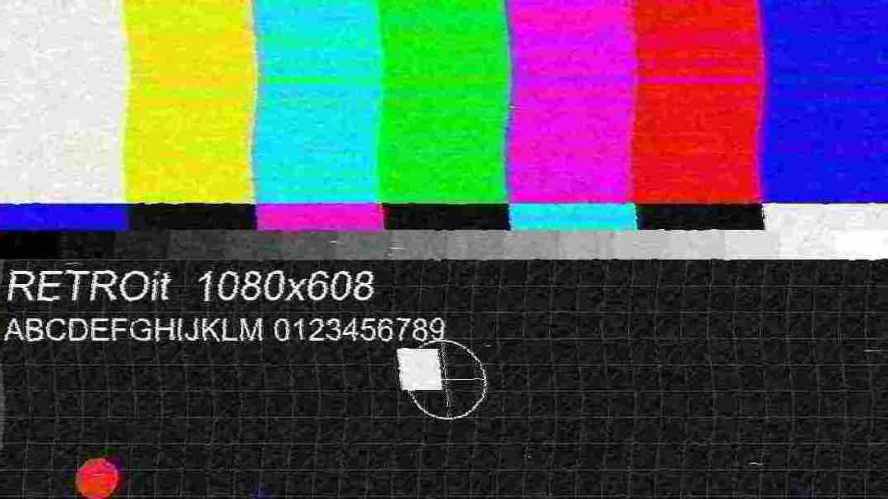](shader/exemplos/saidas/aviso-guerra-fria.mp4) |
| `print-repassado` | cópia de cópia: fita e JPEG pesado, com a grade do JPEG mudando a cada quadro (1080×608) | [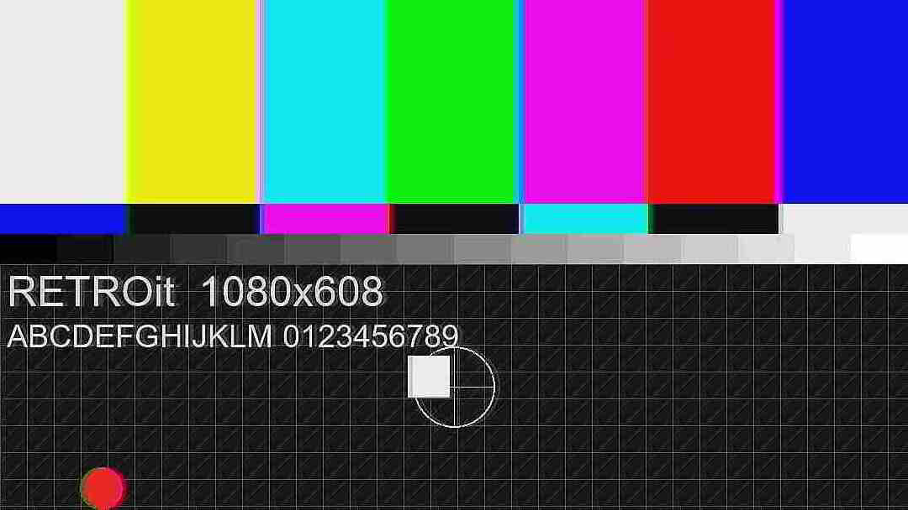](shader/exemplos/saidas/print-repassado.mp4) |
| `varredura-linhas` | linhas repetidas descendo a tela (640×360) | [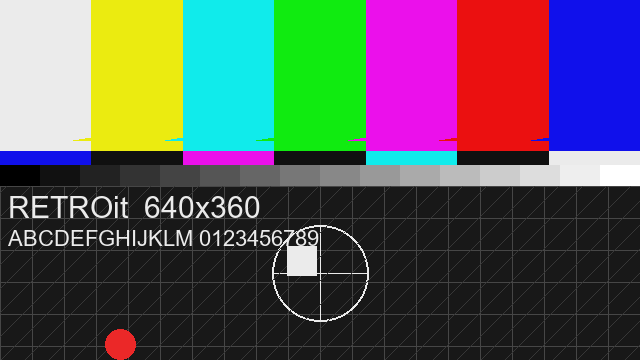](shader/exemplos/saidas/varredura-linhas.mp4) |
| `crt-fosforo` | máscara de fósforo em células arredondadas, bloom, curvatura do tubo, jitter leve, JPEG só na imagem e chuvisco NTSC em pontinhos quadrados de 2,5 a 3 px, em 1920×1080 | [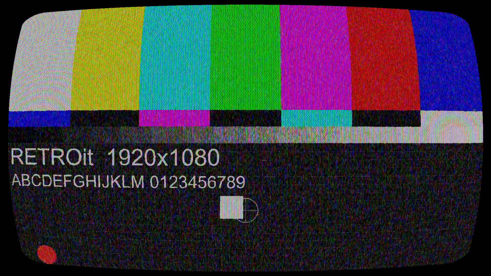](shader/exemplos/saidas/crt-fosforo.mp4) |
| `ps1-jitter` | PS1 com jitter leve e lento (sem guia de movimento, 5 fps) numa peça quase parada, lado a lado | [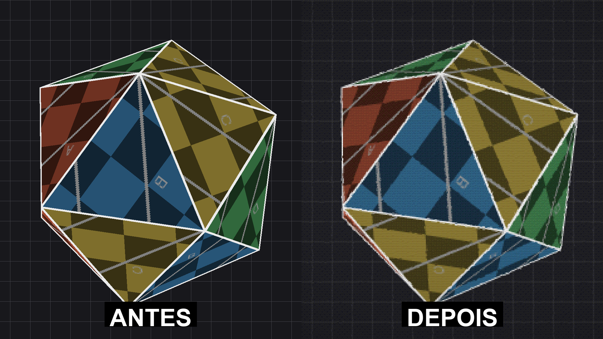](shader/exemplos/saidas/ps1-jitter.mp4) |
| `jitter-blocos` | só o jitter de vértice, blocos quadrados de 16 px deslocados até 3 px, lado a lado | [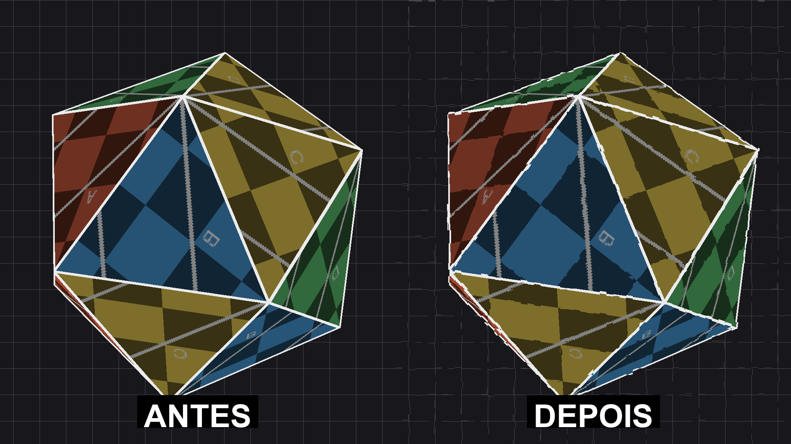](shader/exemplos/saidas/jitter-blocos.mp4) |
| `crt-fosforo-lado` | o preset do CRT sobre a peça low poly, lado a lado | [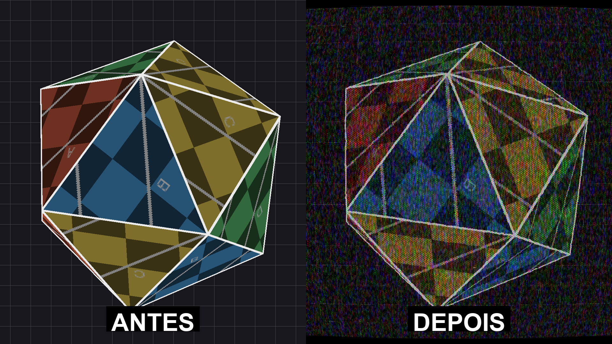](shader/exemplos/saidas/crt-fosforo-lado.mp4) |

`python shader/exemplos/gerar-exemplos.py crt-fosforo` gera só um. `faixa-chuvisco.py` (mesma pasta) faz a faixa de chuvisco NTSC que desce a tela. Como a peça foi construída: nota "Peça low poly para demos" no vault.

## Os efeitos

Os efeitos são **etapas**, e cada uma pode ser ligada, desligada e reordenada arrastando-a na linha da pipeline.

| Etapa | O que faz |
|---|---|
| **Cor** | Gama, sombras levantadas, saturação, contraste e **tonalidade**: um ganho para cada canal (vermelho, verde e azul), para empurrar a imagem para qualquer cor. |
| **Pixel e cor reduzida** | Esconde a resolução em blocos grandes e reduz os bits de cada canal (5 bits dá os 15 bits do PS1), com **dither Bayer** 4×4 ou 8×8. Reduz por média ou por amostra, e pode suavizar as bordas. |
| **Paleta** | Troca as cores por uma paleta de console: **adaptativa** (extraída da própria foto), NES, Game Boy, CGA, EGA, C64, PICO-8, MSX, ZX Spectrum, Apple II, Master System, SNES, Mega Drive e outras. |
| **NTSC / VHS** | Simula o sinal de vídeo analógico: a cor vaza e chega atrasada, bordas com *ringing*, borrão de luminância, ruído, *snow*, onda nas bordas, entrelaçamento, cabeça da fita e rastreio no rodapé. Foi calibrado contra um simulador de referência. O grão tem largura (`ntGrain`) e altura (`ntGrainV`, só no modo ntsc-rs; 1 = uma linha) próprias, para pontinhos quadrados em vez de riscos horizontais. |
| **Distorção** | Curvatura de barril ou almofada, zoom, ondas horizontais e verticais, fatias de glitch, aberração RGB e jitter por linha e tremor vertical da imagem inteira (`dsShake`, em px, a cada N quadros). A opção **Borda fora da imagem** (`dsEdge`) decide o que aparece quando a onda ou o jitter empurram a imagem: 0 preto (padrão), 1 repete a última coluna e linha, 2 espelha. |
| **Fita magnética** | Aberração de croma de fita: croma deslocado em sentidos opostos e borrado na horizontal, eco da luminância, halo nas bordas e riscos de cor. No shader (GPU), igual ao JS. |
| **Recompressão JPEG** | Blocos 8×8, croma em blocos (4:2:0), gerações com a grade deslocada e nitidez excessiva. Roda em JS no navegador e na placa de vídeo no `.frag` (etapa própria), usada pelo `retroit-video.py`. |
| **Jitter de vértice** | Blocos isolados deslocados por alguns pixels, como o tremor de vértices do PS1. O sorteio muda a cada N quadros, não a cada quadro. No modo guiado, só tremem os blocos que se movem entre um quadro e o outro do vídeo. |
| **Halftone** | Pontos de retícula, como em jornal e revista. |
| **Linhas de TV** | Escurece linhas alternadas, com a espessura escolhida em pixels. |
| **Vinheta** | Escurece as bordas, como a lente de uma câmera ou de um tubo. |
| **Ruído branco** | Granulação por pixel, estável: o mesmo quadro sempre dá o mesmo ruído. |
| **CRT** | Máscara de **fósforo** (células R, G e B com cantos arredondados, com ou sem fileiras alternadas), bloom, cantos arredondados da tela e o modo **Fósforo perfect**, que fixa a entrada em linhas (por exemplo 240) e a saída em múltiplos exatos do bloco, para a máscara ficar perfeita pixel a pixel. |
| **Metadados** | Remove ou edita os dados escondidos do arquivo (EXIF, PNG e outros) na exportação. |

São **35 predefinições** de fábrica, como PS1 clássico, Analog horror, VHS locadora, Game Boy, Synthwave 80s, Polaroid, Jornal e as de CRT. Você salva as suas, renomeia, exporta e importa em JSON.

---

## Animação

O **Modo Animar** deixa os efeitos mudarem no tempo: você monta um **Antes** e um **Depois**, e o app interpola entre eles.

- **Transição:** linear, de ida e volta (*boomerang*) ou aleatória.
- **Curva:** presets de aceleração (entra, sai, entra e sai) ou uma curva de Bézier própria.
- **Quadros-chave:** para qualquer parâmetro, pontos no tempo que você arrasta na linha.
- **Aleatório por etapa ou parâmetro:** com semente, para a animação se repetir igual.
- **Exportar:** GIF, WebM, uma sequência de quadros em ZIP e, o mais importante, o **preset animado em JSON**. O script de vídeo lê esse arquivo e aplica a animação num vídeo de verdade.

Na prática, o que o app calcula em cada instante é o que o script calcula: numa animação de teste (duas pipelines, curva, quadros-chave e etapa aleatória), 136 valores comparados em 8 instantes deram diferença máxima de 5×10⁻⁷.

---

## O shader e a portabilidade

O coração do projeto é `shader/retroit.frag`: **um fragment shader** que contém todas as etapas. Ele foi pensado para ser levado para outros lugares.

**Como ele é organizado**
- **Uma passada por etapa.** Um uniform (`u_stage`) escolhe qual etapa roda. Quem usa o shader renderiza numa textura, passa o resultado para a etapa seguinte e repete, na ordem do preset. Isso permite etapas que leem pixels vizinhos (NTSC, distorção) sem truques.
- **Os parâmetros são uniforms com o nome das chaves do JSON.** Um preset é só um dicionário: cada chave vira um uniform de mesmo nome.
- **Sem texturas externas.** Só a imagem de entrada e, quando há paleta fixa, uma lista curta de cores.
- **Ruído determinístico.** Ele vem de um hash de inteiros por pixel e quadro (não de `sin()`), então dá o mesmo resultado no navegador e na placa de vídeo.
- **Tamanhos relativos à largura.** Pixels e blocos escalam com a resolução (referência de 1600 px), então o visual se mantém em qualquer tamanho.

**Onde ele já roda**

| Destino | Situação |
|---|---|
| Navegador (WebGL2), no próprio app | Pronto. O mesmo shader vem embutido no HTML, com uma versão em CPU de reserva. |
| Imagens e vídeos em lote (Python e OpenGL 3.3) | Pronto, em `shader/retroit-video.py`. |
| Godot 4 | Foi portado numa versão anterior do projeto, com saída idêntica à do shader de referência em 9 predefinições. Esse porte não está neste repositório. |
| Unity, Unreal, celular (GLSL ES, Metal) e outras engines | Não feito. O projeto foi desenhado para facilitar (veja abaixo). |

**Como levar para outro dispositivo.** Em qualquer engine, o trabalho é o mesmo:
1. Criar duas texturas de saída e alternar entre elas (*ping-pong*).
2. Para cada etapa da lista do preset, definir `u_stage`, os uniforms e renderizar.
3. Traduzir a sintaxe do shader para a da engine (HLSL, shading language do Godot, GLSL ES, Metal). A matemática das etapas é a mesma.
4. Comparar com a referência: o script de vídeo tem `--compare` para medir a diferença entre dois resultados.

---

## Limitações conhecidas

- **Paleta adaptativa em vídeo:** o app recalcula a paleta a cada quadro. O script de vídeo usa uma só, calculada em quadros amostrados, para a cor não piscar entre cenas.
- **Fósforo perfect** só existe no app, na placa de vídeo do navegador.
- **Resolução:** o visual escala com a largura, mas não é igual pixel a pixel entre a prévia e um vídeo 4K.
- **Fidelidade do NTSC:** é uma aproximação feita em YIQ, calibrada contra um simulador, e não uma simulação física do sinal.

---

## Licença

Software proprietário. Copyright © 2026 Cristiano. **Todos os direitos reservados.** Veja o arquivo `LICENSE`.
